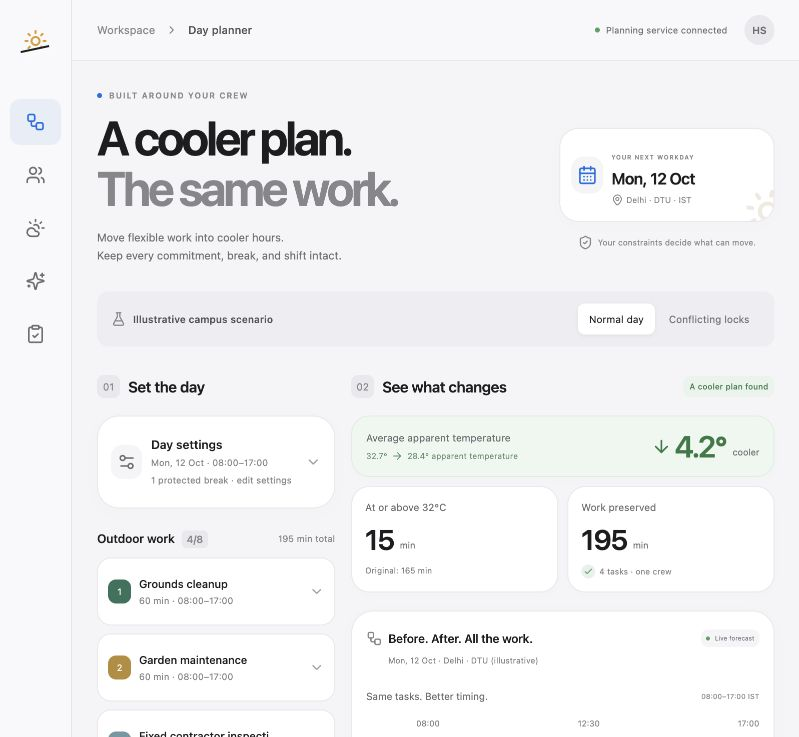

# HeatShift

**A cooler plan. The same work.**

HeatShift helps a campus supervisor move flexible outdoor jobs into cooler available hours while preserving every job, its duration, permitted window, fixed start and the crew's paid shift and breaks. The result is a feasible schedule with weather evidence, ready for human review and export.

Built for **Environmental Hacks 2026 · Heat and Water**, using the permitted **AWS open-source Build It route**. The agent runs AWS's Strands Agents SDK with local Ollama. No AWS cloud deployment, paid inference or AWS credits are used. The [event](https://www.wemakedevs.org/aws/env) gives local and deployed projects the same judging consideration.



See the [conflicting-locks screen](docs/images/conflict.png) and [complete exported forecast comparison](docs/evidence/forecast-comparison-2026-10-11.json). The export retains all 195 work minutes and records a 4.246°C lower forecast average for the illustrative 12 October workload; it is a dated planning result, not a measured health outcome.

## Run locally

Use Python 3.13+, Node.js 22+ and [Ollama](https://ollama.com/download). Start the Ollama desktop app, or run `ollama serve` in its own terminal. Download the local model:

```sh
ollama pull qwen3:1.7b
```

From the repository root, set up and start the backend:

```sh
python3 -m venv .venv
source .venv/bin/activate
python -m pip install -r requirements-dev.txt
export HEATSHIFT_AGENT_PROVIDER=ollama
export HEATSHIFT_AGENT_MODEL=qwen3:1.7b
export OLLAMA_HOST=http://127.0.0.1:11434
python -m uvicorn backend.app:app --host 127.0.0.1 --port 8000 --reload
```

In another terminal, start the frontend:

```sh
npm ci
npm run dev
```

Open **http://127.0.0.1:5187**. Vite forwards `/api` to port 8000. The app loads an editable illustrative campus workload for tomorrow in Asia/Kolkata time and fetches real weather. Internet access is needed for a new forecast; model inference stays local. The planner works even if the assistant is unavailable.

To serve the built interface and API together, stop the development backend, build, then restart:

```sh
npm run build
python -m uvicorn backend.app:app --host 127.0.0.1 --port 8000
```

Open **http://127.0.0.1:8000**. API documentation is at `/docs`. The [local workflow guide](docs/DEPLOYMENT.md) describes the same zero-cloud-spend setup; no cloud deployment files are included.

## Review the useful cases

1. **Normal day:** four jobs, 195 work minutes, a fixed inspection and a protected lunch break. Compare the original and proposed timelines and inspect weather provenance.
2. **A changed constraint:** ask “Garden maintenance can only start after 13:00. Replan the other jobs.” Inspect the actual Strands tool trace, review the proposed change and choose whether to apply it. Acceptance is a separate step.
3. **Conflicting locks:** two jobs require the same crew at the same fixed time. The app reports infeasibility instead of deleting work or moving a lock.
4. **Accept and export:** save the accepted result in this browser, print a report or download JSON containing the request, schedules, metrics and weather evidence. No workers are notified or assigned.

Real weather and local model executions are documented in [Evidence](docs/EVIDENCE.md). The default workload is illustrative, not an actual DTU work order or a field pilot.

## Why the result can be checked

The exact optimizer handles **one crew, one day, up to eight uninterrupted jobs, a shift of at most 12 hours, and 15-minute increments**. It minimizes duration-weighted forecast apparent temperature. Equal results prefer fewer moved jobs, then fewer minutes of movement. Each hourly forecast value is held constant within its four planning slots.

Every job must fit its allowed window and the paid shift without overlapping another job or a break. Fixed starts remain fixed. An invalid original schedule earns no improvement metrics. Impossible constraints produce an explanation. Positive `deltaC` means original average minus proposed average; minutes at or above the chosen marker use `apparentTemperatureC >= thresholdC`.

The agent inspects inputs, validates explicit changes and calls the same deterministic tools. It does not calculate the schedule or approve it. Tool traces come from executed tools. Ambiguous or unsupported edits may be refused; the structured editor provides exact control. See [Agent design](docs/AGENT.md).

Weather results expose their date, source, retrieval time, grid and live/saved status. Cached data retain the original timestamp and must match both date and requested coordinates. Missing values, wrong units or an unavailable source without a usable matching cache return an error; there is no fabricated weather fallback.

## Test

```sh
python -m pytest -q
npm run build
```

Tests cover constraint integrity, invalid comparisons, an independent exhaustive-search oracle, weather failures, agent intent guards and bounded API requests. [Evidence](docs/EVIDENCE.md) records specific runs; mocked tests are distinguished from real model inference.

## Limits

Apparent temperature is a forecast-based planning input, not WBGT, measured personal exposure, a medical threshold or proof of reduced illness. Local shade, exertion, clothing, acclimatization and individual health are not modeled. The app has no multiple crews, travel times, task dependencies or sensor readings.

No work completion, field pilot or measured environmental/health saving is claimed. The next validation is a real supervisor's review of practical schedule changes. Acceptance is local browser storage, and the prototype has no private-team accounts. Read [Privacy](docs/PRIVACY.md) before entering operational data.

## Credits and submission

Original code: [MIT](LICENSE). Third-party software, the Qwen model and Open-Meteo data retain their own terms; see [verified credits and licenses](docs/CREDITS.md). **OpenAI Codex assisted with research, implementation, tests and documentation.**

[2:45 demo script](docs/DEMO_SCRIPT.md) · [Submission draft](docs/SUBMISSION.md) · [Evidence](docs/EVIDENCE.md) · [AWS Builder Center blog draft](docs/BUILDER_BLOG.md)

Add repository and YouTube links only after publication and verification. A cloud-hosted app URL is not required for the selected local route.
